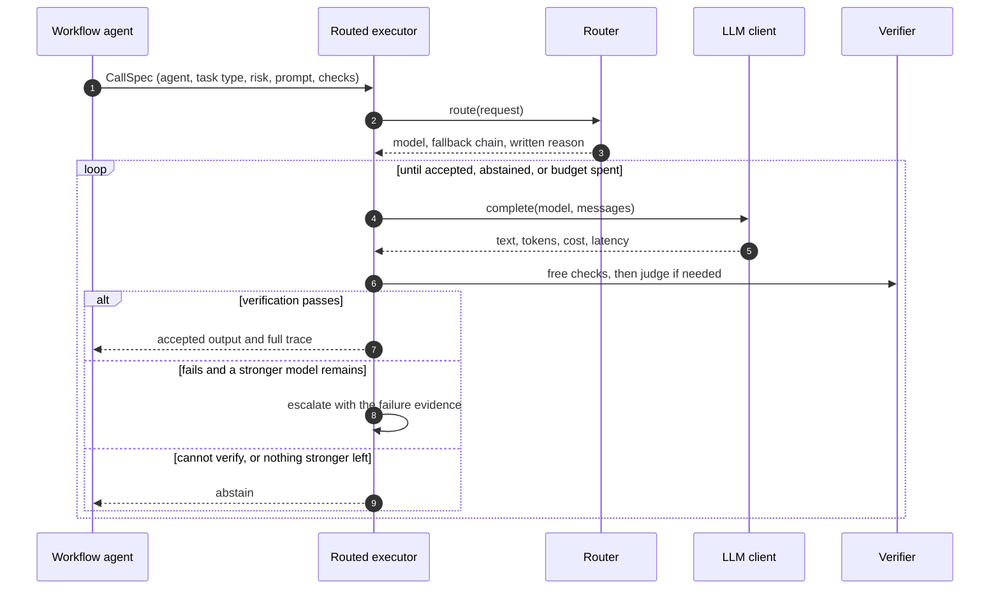
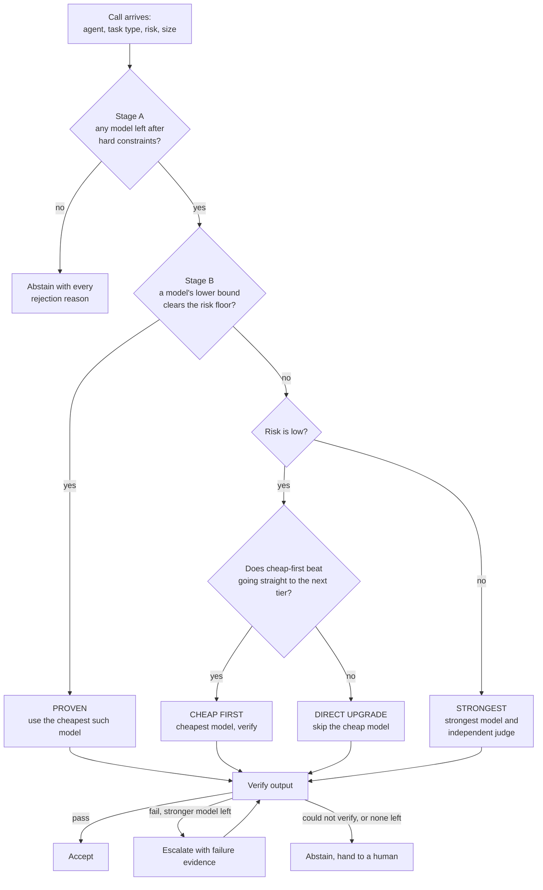

# Agent Model Router

**Choosing the right LLM for every agent call, so output quality stays high and cost stays low.**

When several agents cooperate inside one application, each of them makes LLM calls with very different needs. A planner that must emit valid JSON, a worker extracting a number from an invoice, and a synthesizer writing a final answer do not need the same model. Sending everything to the strongest model wastes money. Sending everything to the cheapest model ships wrong answers. This project is a routing layer that decides, per call, which model to use, checks the result, and escalates only when the evidence says it must.

It is built as a working system rather than a diagram: a routing engine, a verification pipeline, a bounded multi-agent workflow, an HTTP API, a live dashboard, and a reproducible benchmark that measures whether the routing actually helps.


---

## Contents

- [Agent Model Router](#agent-model-router)
  - [Contents](#contents)
  - [1. The problem](#1-the-problem)
  - [2. The approach in one page](#2-the-approach-in-one-page)
  - [3. Architecture](#3-architecture)
    - [What each layer is responsible for](#what-each-layer-is-responsible-for)
    - [One call, step by step](#one-call-step-by-step)
  - [4. How one call is decided](#4-how-one-call-is-decided)
  - [5. Results](#5-results)
    - [What the numbers say](#what-the-numbers-say)
    - [The saving depends on the judge, and the benchmark shows it](#the-saving-depends-on-the-judge-and-the-benchmark-shows-it)
  - [6. Quick start](#6-quick-start)
    - [Using real models](#using-real-models)
  - [7. Repository layout](#7-repository-layout)
  - [8. API](#8-api)
  - [9. Honest limitations](#9-honest-limitations)
  - [10. Further reading](#10-further-reading)

---

## 1. The problem

> *Multiple agents are interacting in an application. How do you make sure the right LLM is being used, so that the output is best and the cost is least?*

The question hides three separate difficulties.

**Quality and cost pull in opposite directions.** The strongest model is the safest default and also the most expensive by one to two orders of magnitude. A cheap model is fine for easy work and fails silently on hard work. "Right" is therefore not a fixed model, it is a model that depends on the agent, the kind of task, how hard this instance is, and how costly a mistake would be.

**Multi-agent systems multiply the stakes.** An error from an early agent is consumed by every later agent. A small planner mistake becomes a wrong plan, which becomes wrong worker output, which becomes a confident wrong answer. Cost also compounds: one user request can trigger many calls, retries and escalations, so a naive "just retry with a better model" loop can burn a budget quickly.

**Nobody can see which model is "good enough".** Provider benchmarks describe models in general. They do not describe *your* tasks. A routing rule written from intuition ("use the small model for extraction") is a guess, goes stale when prices and models change, and cannot be defended in a review.

So the real task is not to pick a model. It is to build a decision process that is **measured, conservative, explainable, and bounded**.

## 2. The approach in one page

The problem is treated as a constrained optimisation, solved per call:

```
minimise    expected cost of the whole workflow
subject to  probability the output is correct  ≥  a floor that depends on risk
            hard rules: privacy, context size, tool support, provider allow-list, budget
```

Four ideas make that practical.

1. **Measure, do not assume.** Each model's success rate is tracked per *agent role × task category* as a Beta distribution. Routing uses the *lower* credible bound (5th percentile), so a model with a lucky streak on little data cannot beat a model with solid evidence. Sample sizes are visible everywhere.
2. **Cheapest model that is provably good enough.** Among the models allowed by the hard rules, pick the cheapest whose lower bound clears the quality floor for that call's risk level (0.80 low, 0.90 medium, 0.95 high).
3. **Verify, then escalate or abstain.** Every output passes a verification pipeline ordered cheapest-first: free deterministic checks, then an independent judge. A failed output escalates to the next tier with the failure evidence attached. If output cannot be verified, or no stronger model remains, the system abstains instead of guessing.
4. **Bound everything.** A per-workflow budget caps cost and call count, the escalation path is finite, and a provider failure falls back to another model. There is no unbounded loop.

Risk changes the strategy, not just a threshold. Low-risk work may start cheap and rely on verification. Medium and high risk work with no proof of capability goes straight to the strongest model with an independent judge, because a wrong answer there costs more than the saving. A model that has not yet proven itself on a kind of task is never trusted on format checks alone: the judge runs for it at every risk level, and only a model with a measured track record at low risk may skip it.

## 3. Architecture


The design has one rule that everything else depends on: **no agent talks to a model directly**. Every call goes through the routed executor, which routes, generates, verifies and decides, under a budget. That single choke point is what makes cost, quality and safety enforceable instead of aspirational.

### What each layer is responsible for

| Layer | Responsibility | Why it is separate |
|---|---|---|
| Model catalog | Facts about models: price, context window, tool and structured-output support, whether approved for sensitive data, enabled or not | Prices change often; they belong in data, not code. Models with unverified prices ship disabled. |
| Capability registry | What we *measured* about each model on each kind of task | Quality evidence is a different thing from a price list and is updated by a different process (the benchmark). |
| Router | Pure decision logic: given a request, return a model, a fallback chain and a written reason | Pure functions are easy to test exhaustively and to explain. |
| LLM client | One place that calls providers and records tokens, latency and cost | Cost accounting must be uniform or comparisons are meaningless. |
| Verification | Decides whether an output is acceptable | Separating "generate" from "judge" is what makes cheap-first safe. |
| Routed executor | The bounded loop: route, generate, verify, accept, escalate or abstain | The only code allowed to call a model, so no call can bypass routing or budgeting. |
| Workflow and agents | Planner, workers, synthesizer, context compression between hops | The application a real team would already have; routing plugs in underneath it. |
| Benchmark | Measures all of the above against ground truth, with significance tests | Without measurement the routing is just another opinion. |

### One call, step by step



## 4. How one call is decided



The cheap-first decision is a calculation, not a belief. Trying a cheap model first costs

```
E[cost] = c_cheap + c_verify + P(escalate) · (c_strong + c_verify)
```

and only beats going directly to the stronger model when that is smaller than `c_strong + c_verify`. The router evaluates this with the measured failure rate of the cheap model and skips the cheap step when it would lose.

## 5. Results

The benchmark runs five strategies on the same tasks and scores every answer against exact ground truth.

> **What is simulated.** The models are simulated: their skill per task category and difficulty, and the judge's accuracy, are stated assumptions in [`world.py`](backend/app/benchmark/world.py) and [`verifiers.py`](backend/app/benchmark/verifiers.py). The results therefore show that the *method* works and how it behaves, not how any specific commercial model performs. The harness is the same one real models plug into.

**Setup:** 1,000 generated tasks across five categories and three difficulties, split 40 / 20 / 40 into train, validation and held-out test, stratified. Capability profiles are learned on train only, the low-risk floor is tuned on validation only, and every number below is measured once on the 415 held-out tasks, repeated 5 times with different random draws.

| Strategy | Success rate (95% CI) | Cost per success | Wrong but accepted | Escalated |
|---|---|---|---|---|
| Fixed cheap model | 68.0% (66.0 – 70.0) | $0.0000126 | 32.0% | – |
| Complexity-only routing | 84.9% (83.3 – 86.3) | $0.000524 | 15.1% | – |
| Fixed strongest model | 97.5% (96.7 – 98.1) | $0.000771 | 2.5% | – |
| Router, cold start (no profiles) | 97.2% (96.3 – 97.8) | $0.000784 | 0.7% | 8.0% |
| **Router, learned profiles** | **97.1% (96.3 – 97.7)** | **$0.000709** | **1.0%** | 13.4% |

### What the numbers say

- **Quality matches the strongest model.** Against always using the strongest model, the success difference is −0.4 points (95% CI −1.3 to +0.5, McNemar p = 0.58): statistically indistinguishable.
- **Cost per success is lower**, by about 8% (paired bootstrap CI excludes zero). Learning the profiles is worth almost 10% on its own: the cold-start router reaches the same quality at $0.000784.
- **Far fewer wrong answers reach the user.** The cheap-only baseline returns a wrong answer one time in three and does not know it. The router's verification and escalation cut that to about 1%.
- **Routing by prompt complexity alone is not enough.** It is 12 points worse in success than the router (p < 0.001) because difficulty depends on the task type, not on prompt length.
- **The router adapts per category.** Extraction and summarization are mostly answered by the small model, reasoning and coding mostly by mid and frontier.

### The saving depends on the judge, and the benchmark shows it

Verification is not free. How much the router saves depends on what the judge costs and how well it catches mistakes:

| Judge assumption | Router success | Strongest model | Wrong but accepted | Cost saving |
|---|---|---|---|---|
| Mid-tier judge, catches 85% (main result) | 97.1% | 97.5% | 1.0% | +8.0% |
| Cheap judge, catches 70% | 95.3% | 97.5% | 1.9% | +48.7% |
| Cheap judge, catches 50% | 94.7% | 97.5% | 1.5% | +37.5% |
| Mid-tier judge, catches 60% | 94.9% | 97.5% | 1.2% | −3.2% |

A cheap judge unlocks large savings but lets a few more errors through. An expensive, weak judge can make the router cost *more* than the strongest model. The judge is part of the system and has to be measured like everything else.


## 6. Quick start

Requirements: Python 3.11+, Node 20+.

**Backend** (from the repository root, Windows `cmd` shown; on macOS or Linux use `source .venv/bin/activate`):

```
cd backend
python -m venv .venv
.venv\Scripts\activate
pip install -e ".[dev]"
pytest -q
uvicorn app.main:app --reload
```

API docs open at http://localhost:8000/docs.

**Reproduce the benchmark** (about 45 seconds, writes `data/benchmark_results.json` and `data/capability_profiles.json`):

```
cd backend
python -m app.benchmark.cli
```

Options: `--tasks 1000 --repeats 5 --seed 0 --no-sensitivity`. The run is fully deterministic for a given seed.

**Dashboard:**

```
cd frontend
npm install
npm run dev
```

Open http://localhost:5173. The Live run tab uses simulated models, so it is free and works offline.

### Using real models

Real provider entries exist in [`models.json`](backend/app/registry/models.json) but are disabled, because prices must be verified against the provider's current pricing page first. Live mode on the API refuses to run, with a clear `409`, until a real model is enabled and its provider key is set.

The repository includes tooling to measure real models instead of assuming their skill. It works on free tiers: the demo setup uses two Groq models as workers (`groq-gpt-oss-20b` as the cheap one, `groq-gpt-oss-120b` as the stronger one) and a Google AI Studio model as the independent judge (`gemini-3.5-flash-lite`), so the judge comes from a different provider than the workers. Measured results and the reasoning are in [`docs/LIVE_VALIDATION.md`](docs/LIVE_VALIDATION.md).

1. Copy `backend/.env.example` to `backend/.env` and add `GEMINI_API_KEY` and `GROQ_API_KEY`. Keep the file out of version control.
2. **Profile** the workers. This sends the benchmark tasks to the real models, grades each answer against its known result, and writes measured capability profiles. Calls are throttled per provider, spend and call counts are capped, transient errors are retried and never counted as a model failure, and the run resumes if interrupted.

```
cd backend
python -m app.profiling.cli --models groq-gpt-oss-20b groq-gpt-oss-120b --dry-run   # estimate only
python -m app.profiling.cli --models groq-gpt-oss-20b groq-gpt-oss-120b --tasks 100 --yes
```

3. **Trace** the real router and judge on tasks the profiler never saw. For each task it records which model answered, why the router chose it, whether the judge sent the answer back and with what reason, and whether every answer was actually right. The summary reports the judge's measured catch rate and false-reject rate.

```
python -m app.profiling.trace_cli --workers groq-gpt-oss-20b groq-gpt-oss-120b --judge gemini-3.5-flash-lite --yes
```

4. **Compare judges** on identical items, each task with its right answer and a plausible wrong one, to see which judge actually catches mistakes and which wrongly rejects good answers.

```
python -m app.profiling.judge_cli --judges groq-gpt-oss-120b gemini-3.5-flash-lite --yes
```

Outputs go to `data/live_capability_profiles.json`, `data/live_profile_report.json`, `data/live_routing_trace.json` and `data/live_judge_eval.json`. They are kept separate from the simulated profiles, because the two describe different models. To use a dedicated judge in the API, set `JUDGE_MODEL` or pass `judge_model` on a `/run` request; a judge never writes answers, so it cannot grade its own work.

Free tiers cost nothing in practice. The tools report a notional cost at list price so the economics stay visible. Free-tier content may be used by the provider, so never send sensitive data through them.

## 7. Repository layout

```
agent-model-router/
├── backend/
│   ├── app/
│   │   ├── core/          settings, logging, shared enums (tiers, risk, agent roles, task types)
│   │   ├── registry/      model catalog + capability registry (Beta statistics)
│   │   ├── router/        constraints, policy, cascade maths, decision engine
│   │   ├── llm/           provider-agnostic client, simulated models, cost accounting
│   │   ├── verification/  deterministic checks, judge, cheapest-first pipeline, outcome rules
│   │   ├── workflow/      budget, executor loop, multi-agent runner, traces
│   │   ├── agents/        planner, worker, synthesizer definitions
│   │   ├── api/           FastAPI routes, schemas, serializers, application factory
│   │   ├── benchmark/     tasks, simulated world, strategies, statistics, CLI
│   │   └── profiling/     live profiling, rate limiting, live routing trace
│   └── tests/             160+ automated tests
├── frontend/              React + TypeScript dashboard
├── data/                  benchmark results, simulated and measured capability profiles
└── docs/                  LOGIC.md, TECHNICAL.md, images
```

## 8. API

| Method | Path | Purpose |
|---|---|---|
| GET | `/health` | Service status, version, configured providers |
| GET | `/models` | Full catalog including disabled models and their prices |
| POST | `/run` | Run the multi-agent workflow and return the complete trace |
| GET | `/benchmark` | The latest saved benchmark results |

`POST /run` takes the task, a mode (simulated or live), a risk level, a task type, a sensitivity flag, budget limits and an optional dedicated judge, and returns the final answer plus, for every agent call: the model chosen, the routing mode and written reason, every candidate with its measured rate, lower bound and sample size, each attempt with its checks and cost, and the budget used. When a call was handed to a stronger model, `escalation_steps` states why: the check that failed, the judge that said so and its reason, and what the rejected attempt cost.

## 9. Honest limitations

- **The headline benchmark is simulated.** Skill tables and judge accuracy there are assumptions. The mechanism is validated; absolute numbers are not predictions for real models. The profiling and trace tools above replace those assumptions with measurements for the models you enable, and the measured numbers belong to that run, that task set and that date.
- **Profiles are per task category, not per difficulty.** Averaging hard and easy tasks inside a category blurs the evidence. A difficulty signal is the most valuable next refinement.
- **Ground truth is cheap here and expensive in production.** The benchmark has exact answers. A real deployment needs labelled samples or a trusted evaluator to keep profiles fresh and to detect drift.
- **The judge is a model of a judge.** Real judges have correlated blind spots with the models they grade, which is why the router prefers a judge from a different provider and why deterministic checks run first.
- **One seed, one task generator.** Results are repeated across random draws, but the task distribution itself is fixed.
- **Not built yet:** per-agent ablation, exhaustive-versus-greedy budget allocation across agents, routing of the verifier role through the capability registry, parallel workers, and human approval for side-effecting tools.

## 10. Further reading

- [`docs/LOGIC.md`](docs/LOGIC.md): a concrete scenario, the reasoning behind the approach, why it was chosen over the alternatives, and where each alternative still makes sense.
- [`docs/LIVE_VALIDATION.md`](docs/LIVE_VALIDATION.md): the router on real models: why a cheaper model gets escalated, how judges compare, what verification really costs, where the simulated numbers came from and what to measure instead.
- [`docs/TECHNICAL.md`](docs/TECHNICAL.md): stack, module internals, algorithms, API contract, evaluation methodology, testing, configuration, failure behaviour and how to extend the system.
